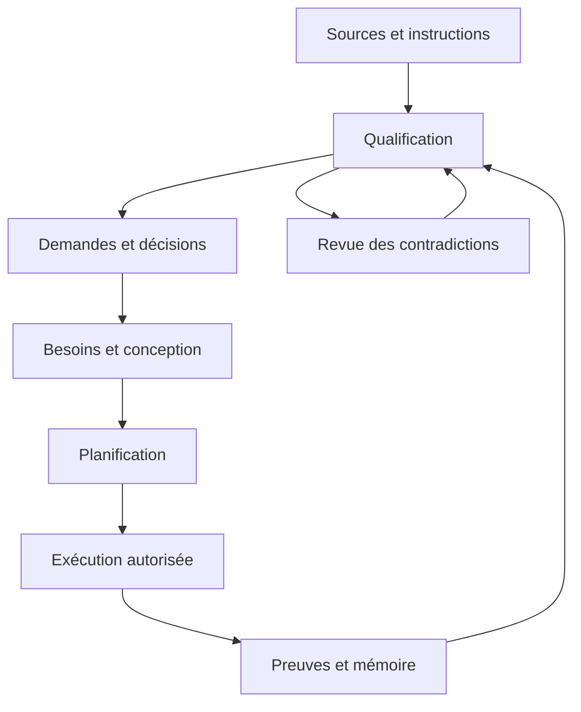

# ARCHITECTURE — Looping-

## System context
Le projet reçoit des intentions et informations pour constituer, concevoir, planifier et faire évoluer un projet logiciel avec une mémoire durable. La base de conception utilisateur est référencée dans docs/intake/BASE_REGISTRY.json. Les décisions de stockage documentaire de ce lot sont acceptées par ADR-0002 ; les capacités applicatives ci-dessous sont une cible à détailler, pas un runtime déployé.

## Current architecture
Le dépôt est une instance initialisée du Governed Repository Template. Il contient des autorités Markdown, des projections JSON, un intake natif, une file de travaux, des sessions/claims et des scripts/workflows de gouvernance. Il contient également le corpus documentaire importé. Aucun serveur applicatif, interface web ou moteur Loop raccordé à BASE n’est attesté par les informations consultées.

Le stockage actif de ce lot est Git : les textes et catalogues sont versionnés et relus après commit. Le pointeur canonique existant route vers les propriétaires. La mémoire des sources reste distincte des demandes, des décisions, des tâches exécutables et des preuves. Le référentiel importé conserve son rôle de projection de référence ; son adoption comme base de conception n’active pas ses technologies.

## Components/modules

| ID | Responsabilité logique | Propriétaire ou mécanisme actuel | État de la cible |
|---|---|---|---|
| M01 | Sources et référentiel initial | docs/intake/, sources U10/A01, CONVERSATION_LEDGER | Registres documentaires présents ; collecte universelle future |
| M02 | Qualification et coordination documentaire | Intake natif, ADR, WORK_METHOD | Revue documentaire appliquée ; orchestration automatique à concevoir |
| M03 | Besoins, règles métier et conception | PROJECT_CONTEXT, ARCHITECTURE, demandes | Contexte et architecture initiale documentés ; cahier des charges détaillé à construire |
| M04 | Demandes et planification | REQUESTS.json, ROADMAP, TODO | Registre documentaire présent ; pas une queue d’exécution |
| M05 | Adaptation à l’exécution et aux preuves | Work-items/claims existants, scripts/CI, WORK_LOG | Mécanismes hérités présents ; CI complète bloquée ; nouveaux cycles non démontrés |
| M06 | Mémoire, état et continuité | Pointeur canonique, STATUS, ACTIONS, checkpoint/handoff | Routage documentaire présent ; aucune nouvelle session GACR créée |

Les flèches décrivent le contrat cible de traitement. Elles ne prouvent pas un orchestrateur actif. Les demandes, sorties et critères sont détaillés dans leurs propriétaires plutôt que recopiés dans chaque module.

## Data stores and ownership
Les textes utilisateur et snapshots gardent leur propriétaire d’archive. Le ledger enregistre ordre connu, empreinte et couverture. REQUESTS.json est le propriétaire détaillé des demandes, de leur contexte, de leurs dépendances et critères. Les ADR portent les décisions ; ARCHITECTURE porte le modèle courant/cible ; ROADMAP porte l’ordre des phases ; le registre de travaux natif porte les tâches exécutables.

Relations attendues : source → demande ; demande → décision/document/composant ; demande → phase ; phase → livrable ; exécution → preuve ; preuve → état/checkpoint. Les liens sont typés : composition, dépendance, provenance et impact ne sont pas interchangeables. Les statuts documenté, spécifié, implémenté, testé et déployé restent distincts.

Une base SQL pourra devenir une projection interrogeable après décision sur le modèle, les besoins et la migration. Aucun fichier binaire SQLite ni serveur PostgreSQL n’est créé pour ce lot. Git et les JSON restent les propriétaires canoniques retenus ici.

## External integrations and ports
- GitHub : lecture, commits gardés, workflows et preuves natives ; surface observée pour ce travail.
- MCP : référence et adaptateur éventuel d’exécution ; toute opération live exige sa propre vérification de disponibilité, de cible et d’autorité.
- Prototype loop.py : capacités examinées dans ENGINE_BINDING ; chargeur BASE, classification thématique et impact automatique restent à concevoir.
- Frontend/backend futurs : Atomic Design pour la composition d’interface, DDD pour le métier, ports/adaptateurs pour isoler les dépendances ; choix de distribution/API/EDA/CQRS selon besoins qualifiés.

Les contrats métier ne dépendent pas d’un fournisseur MCP particulier. Le raccordement doit réutiliser les mécanismes présents dans Looping- plutôt qu’installer une seconde file ou transférer les autorités d’un dépôt source.

## Trust boundaries
L’auteur d’une instruction, l’acteur GitHub authentifié, le rôle déclaré, l’intention de connexion, les permissions natives et l’autorisation d’une opération sont des dimensions distinctes. Une source archivée ne constitue pas une instruction locale exécutable. Les fichiers AGENTS.source.md historiques n’entrent pas dans la gouvernance de ce dépôt. Les secrets ne sont pas conservés dans les registres.

## Deployment topology
État non résolu dans .governance/infrastructure-intent.json. Aucun serveur, domaine, conteneur, broker, cluster ou environnement de production n’est déclaré actif. Docker, Kubernetes et les microservices de la base sont des éléments de conception à qualifier ; leur présence dans le référentiel ne les rend pas déployés.

## Observability
Observations GitHub, empreintes, intake/cursor, décisions, ACTIONS, WORK_LOG, runs et erreurs CI. Les horodatages d’enregistrement ne sont pas des dates reconstruites de conversation. Les fonctionnalités de liveness héritées ne sont pas déclarées live pour cette session directe. Voir STATUS et les preuves pour la couverture réelle.

## Rollback / recovery
Historique Git append-only, pas de force-push ni réécriture. Une correction réversible s’effectue par commit additif ou revert contrôlé selon les dépendances. Reprendre le checkpoint, reobserver HEAD, vérifier les propriétaires et réconcilier les modifications avant écriture. Une contradiction conserve les deux sources et une disposition explicite.

## Architectural constraints and open decisions
Conserver la base en huit familles, la frontière source/client du template et l’indépendance des autorités. Ne pas restaurer aveuglément dans le client les fichiers source-only manquants qui bloquent la CI. Restent ouverts : contrats détaillés W1, cahier des charges, schéma exécutable BASE, règles de classement et d’impact, critères du prototype, profil technique et topologie. Tout choix qui invalide une décision antérieure exige un ADR.

## Baseline de l’architecture observée
Le snapshot complet, les composants présents et leurs limites sont possédés par docs/baseline/BASELINE.json. Le plugin GSCC GitHub MCP est présent en source avec son Dockerfile ; il n’est pas attesté construit ou déployé pour Looping-. Les défauts d’appels vers les ressources source-only sont analysés dans CI_COMPATIBILITY. Le prochain travail précise W1, sans activer le modèle cible.
